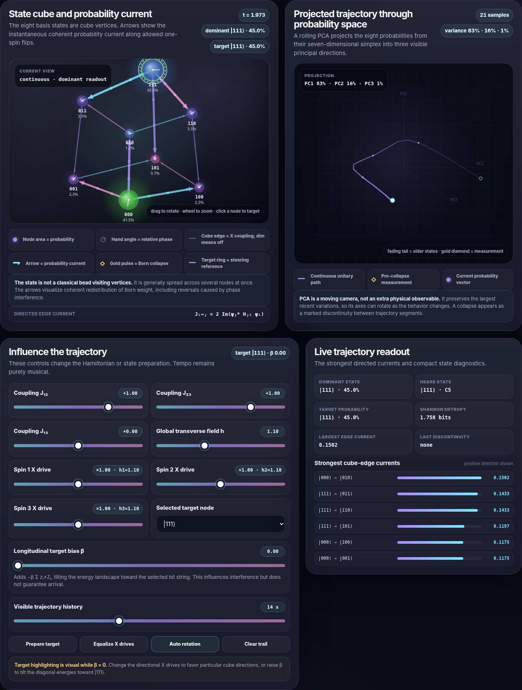

# Hamiltonian Melody

An interactive, self-contained web app that turns a three-spin transverse-field Ising model into music. It combines continuous quantum evolution, optional Born-rule measurement, Web Audio synthesis, a live Hamiltonian matrix, and trajectory visualizations of all eight computational-basis states.



## Run it

Open `index.html` directly in a modern browser. No server, package manager, build step, external fonts, or network connection is required.

Web Audio requires a user gesture, so press **Start melody** before expecting sound.

## Highlights

- Simulates an eight-dimensional, three-spin quantum state
- Evolves the state under a transverse-field Ising Hamiltonian
- Maps each computational-basis state, from `000` through `111`, to a pitch
- Supports binary-order and Hamming-weight note mappings
- Offers deterministic dominant-state playback and stochastic Born sampling
- Visualizes the complete 8 × 8 Hamiltonian matrix
- Shows live basis-state probabilities, amplitudes, and relative phases
- Animates probability current on an interactive state cube
- Projects recent probability vectors into a rolling three-dimensional PCA trajectory
- Includes controls for couplings, transverse drives, target bias, tempo, scale, and sound
- Runs entirely in the browser using the Web Audio API

## Hamiltonian

The default model is

```text
H = -J12 Z1Z2 - J23 Z2Z3 - J13 Z1Z3 - sum_i h_i Xi
```

with defaults:

```text
J12 = 1
J23 = 1
J13 = 0
h1 = h2 = h3 = 1.10
```

The State Trajectory screen can also apply an optional longitudinal target bias:

```text
-beta sum_i z_i* Zi
```

This tilts the coherent energy landscape toward a selected bit string. It does not introduce dissipation or guarantee arrival at the target.

## Evolution modes

### Continuous evolution, default

The state evolves smoothly under the Schrödinger equation. Simulation time advances independently of musical tempo. BPM determines only when the app emits note events.

### Fixed step

Each musical event advances the state by one configurable unitary step:

```text
|psi'> = exp(-i H delta-t) |psi>
```

## Note-selection modes

### Dominant State, default

At each note event, the app plays the basis state with the largest Born probability. It does not measure or collapse the wavefunction, so unitary evolution continues uninterrupted.

### Born Sampling

At each note event, the app samples from the Born probabilities, plays the sampled state's pitch, collapses to that computational-basis state, and immediately resumes evolution.

## State Trajectory visualization

The trajectory screen combines two synchronized views:

1. **State cube:** The eight computational-basis states are the cube's vertices. Node area represents Born probability, phase hands show relative complex phase, and arrows display instantaneous probability current along one-spin-flip edges.
2. **PCA trajectory:** Recent eight-component probability vectors are projected into three visible principal directions, producing a fading trail that reveals loops, oscillations, lingering regions, and collapse discontinuities.

The directed probability current is computed as

```text
J(from -> to) = 2 H(to,from) Im(conj(psi_to) psi_from)
```

The state is generally distributed over multiple nodes simultaneously. The cube therefore depicts coherent probability flow, not a classical particle following one exclusive path.

## Controls

The app includes controls for:

- `J12`, `J23`, and `J13`
- Global and per-spin transverse drives
- Magnet directions and basis-state preparation
- Optional longitudinal target bias
- Continuous or fixed-step evolution
- Dominant-state or Born-sampling playback
- Binary or Hamming-weight pitch mapping
- Musical scale, BPM, volume, and synthesis
- Cube rotation, zoom, and trajectory-history duration

## GitHub Pages

This repository is ready for static hosting. In GitHub:

1. Open **Settings**.
2. Select **Pages**.
3. Under **Build and deployment**, choose **Deploy from a branch**.
4. Choose `main` and `/ (root)`.
5. Save.
